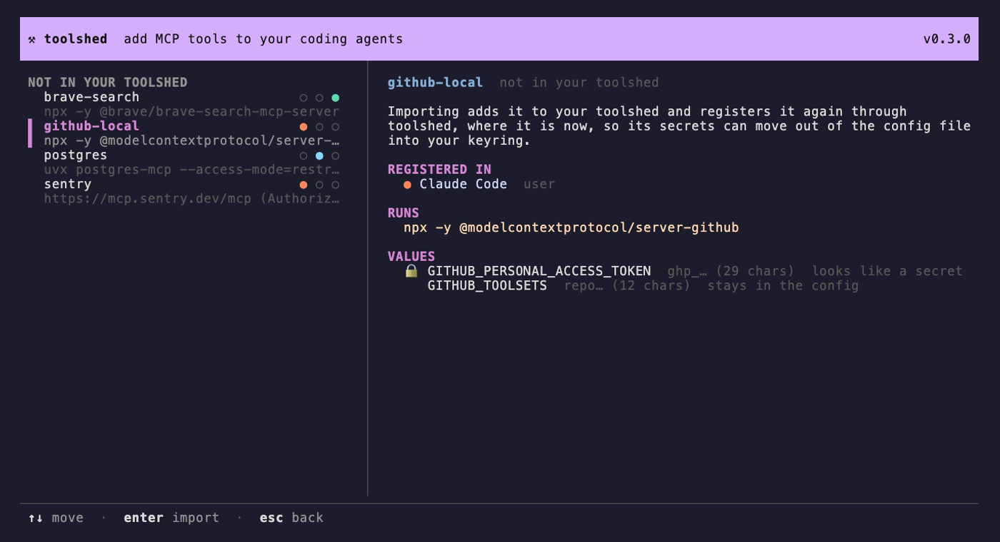

# Import

<!-- summary: Adopt the servers you already set up by hand -->

If you've been adding MCP servers to Claude Code, Codex or Antigravity by hand, their
tokens are probably sitting in `~/.claude.json` and `~/.codex/config.toml`
in plain text.

```sh
toolshed import
```

finds every server your clients have that isn't in your toolshed
yet: your user-wide ones, and the current repository's. For each one it:

1. shows the command (or URL) and asks whether to import it;
2. lists its values and asks which are secrets, starting from a guess: by
   name (`*TOKEN*`, `*SECRET*`, `*PASSWORD*`, `*API_KEY*`, `*_KEY`,
   `Authorization`, …), and any URL with a password in it
   (`postgresql://app:…@db/app`);
3. adds it to your registry, with every value as an input. The registry
   never gets the values, so it stays safe to share;
4. installs it again where it was: secrets go to the keyring and the server
   is registered through toolshed, so the token leaves the config file. Other
   values stay in the client's config.

`-y` imports everything with the guessed secrets, `--dry-run` only shows what
it would do, and `--no-install` only adds to the registry. `toolshed import
<name>` imports one server.

## In the TUI

Press `m`. You get the same list, with where each server is registered, what
it runs, and its values masked. Press `enter`, tick which values are secrets
(the guesses are ticked already), and `enter` again.



## Details

- Settings toolshed doesn't manage stay as they are: a Claude `timeout`, or
  Codex's `startup_timeout_sec`, enabled tools and approvals.
- Names that aren't valid ids (`My_Server`) are imported as one
  (`my-server`), and the old name is removed.
- If your clients run different things under the same name, the first
  one's (Claude Code, then Codex, then Antigravity) is imported and the
  others are left alone.
- Remote servers that send fixed headers (`Authorization: Bearer …`) get
  those headers as inputs, and the credential ones move to the keyring. A
  Codex server that reads its token from your environment
  (`bearer_token_env_var`) keeps doing that.
- Servers that use the old SSE transport are skipped.
- A server registered through toolshed whose registry entry you deleted is
  imported with its secrets where they already are.
- Imported packages aren't pinned, because toolshed keeps exactly what was
  running. `toolshed doctor` points them out, and `toolshed upgrade` pins
  them.
